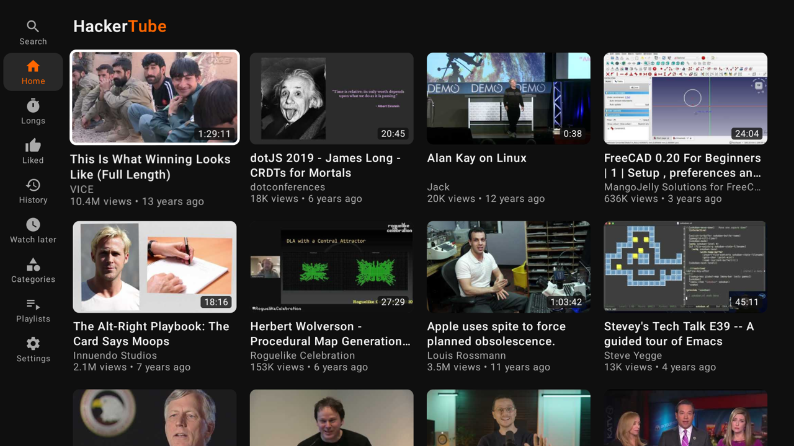

# HackerTube TV

**YouTube on your TV, without YouTube's recommendations.**

HackerTube TV is an unofficial Android TV and Google TV app for [hackertube.org](https://hackertube.org), the list of YouTube videos Hacker News keeps telling each other to watch. Browse it with the remote in a four-column grid made for the TV, press OK, and the video plays in the regular YouTube app. Press Back and you are on the same card again, not in YouTube's suggestions.

Free, no account and no sign-in; your likes and history stay on the TV. The code is open (GPL-3.0), so you can read exactly what it does. Installing takes a few minutes, see [Install](#install-sideload-no-play-store).



## Features

- A home feed that works like the site's: a grid of cards with thumbnail, duration, title, channel, views and age, loading more as you scroll.
- The site's own menu on the left: Search, Home, Longs, Liked, History, Watch later, Categories, Playlists and Settings.
- Press OK on a card to play the video in the YouTube app. Back returns you to the same card.
- Hold OK on a card for a small menu: Like, Watch later and Not interested.
- Likes, dislikes, watch later and history stay on the TV and shape the home feed the way they do on the site.
- Play all for playlists.
- Frames from the middle of each video instead of the uploader's thumbnail, like on the site (on by default, can be turned off in Settings).

## Requirements

- An Android TV or Google TV with Android 8.0 or newer and the YouTube app installed.
- Tested on one TCL Google TV running Android 14.

## Install (sideload, no Play Store)

1. Turn on Developer options: Settings > System > About, then click the Android TV OS build seven times.
2. Install the free "Downloader" app from Google Play on the TV.
3. Allow Downloader to install unknown apps (Settings > Apps > Security & restrictions > Unknown sources, or the prompt the first install shows).
4. In Downloader, enter this link to the latest release and install the app it downloads:
   `https://github.com/hprpic/hackertube-tv/releases/latest/download/HackerTube.apk`

Menu names differ a little between TV brands.

### Typing in Search

If the TV shows "Use the keyboard on your mobile device" and no on-screen keyboard, switch the TV keyboard in Settings > System > Keyboard (current keyboard) to an on-screen keyboard, or type on the phone with the Google TV app.

### Updating

Install the new APK over the old one the same way. Likes and history stay.

## Building from source

You need JDK 21 and the Android SDK (platform 37). Put the SDK location in `local.properties` (`sdk.dir=...`), then run:

```
./gradlew :app:testDebugUnitTest :app:assembleDebug
```

A release build without your own signing key comes out unsigned (`app-release-unsigned.apk`). If `signing/keystore.properties` exists, the signing config is read from it with three keys, `storePassword`, `keyPassword` and `keyAlias`, and the keystore itself is expected at `signing/hackertube-tv.jks`.

## How it works

The app reads the same JSON endpoints the site uses, caches responses for 10 minutes and never polls. To play a video it opens YouTube with an `ACTION_VIEW` intent on the watch URL, with the extras `finish_on_ended` and `force_fullscreen`, so the player closes and returns to the app.

## Credits and disclaimer

The list, descriptions and categories come from hackertube.org; videos and images come from YouTube. This app is not affiliated with hackertube.org, YouTube or Google. If the site changes, the app may stop working until it is updated.

## License

GPL-3.0 for the code in this repository (see [LICENSE](LICENSE)). It does not cover the site's data or YouTube content.

## Contact

Hrvoje Prpić, `hrvojeATprpic.biz`
